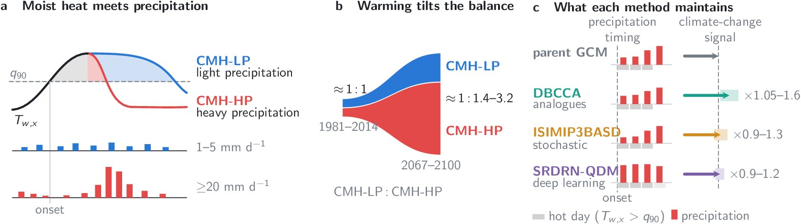

<div align="center">

# Warming Shifts Compound Moist Heatwave–Precipitation Events Over Southeast Asia Toward Heavy-Precipitation Type

**Nguyen Ngoc Kim Hong<sup>1</sup>, Koji Dairaku<sup>2</sup>, Weixuan Rosa Xu<sup>3</sup>, Thanh Ngo-Duc<sup>4</sup>**

<sup>1</sup>Graduate School of Science and Technology, University of Tsukuba, Japan<br>
<sup>2</sup>Department of Engineering Mechanics and Energy, University of Tsukuba, Japan<br>
<sup>3</sup>Cooperative Institute for Modeling the Earth System, Princeton University, USA<br>
<sup>4</sup>University of Science and Technology of Hanoi, Vietnam Academy of Science and Technology, Vietnam

[](https://doi.org/10.5281/zenodo.24006371)
[](LICENSE)
[](#requirements)
[](#citation)

**Code and sample data for the paper** · [Zenodo archive](https://doi.org/10.5281/zenodo.24006371) · [Schematic (PDF)](Fig00_schematic.pdf)

</div>

---

## Contents

- [Overview](#overview)
- [Highlights](#highlights)
- [Study design](#study-design)
- [Repository structure](#repository-structure)
- [Quick start](#quick-start)
- [Data](#data)
- [Citation](#citation)
- [License](#license)
- [Acknowledgments](#acknowledgments)
- [References](#references)

---

## Overview

In tropical Southeast Asia, **moist heat rarely occurs without precipitation**, yet the two hazards are usually projected separately. This project classifies moist heatwaves by the precipitation around their onset, into **compound moist heatwaves with light precipitation (CMH-LP)** and **with heavy precipitation (CMH-HP)**. It then asks four questions:

1. How often does each type occur today, and how do the two types differ?
2. How does the balance between them change by 2100 under four emission scenarios?
3. How much do the projections depend on the **downscaling method**?
4. How strongly are the two types modulated by **ENSO**, and are they predictable a season ahead?

<p align="center">
  
</p>

> **(a)** A moist heatwave is a period of at least three consecutive warm-season days on which the daily maximum wet-bulb temperature $T_{w,x}$ exceeds its local 90th percentile $q_{90}$. Each event is classified by the largest daily precipitation within three days of its onset: **CMH-LP** (1–5 mm d⁻¹) or **CMH-HP** (≥ 20 mm d⁻¹).
> **(b)** Ratio of CMH-LP to CMH-HP event days over Southeast Asian land, 1981–2014 and 2067–2100, across four SSPs.
> **(c)** What each downscaling method maintains. *Left:* daily precipitation during CMH-HP from onset (day 0) to day +3 (land mean, 1981–2014, median of 17 CMIP6 models); grey cells are days with $T_{w,x}>q_{90}$. *Right:* ratio of the projected change in event number, event days and longest event to that of the parent GCM.

---

## Highlights

- 🌡️ **Two distinct compound types today.** CMH-LP and CMH-HP are **equally frequent** (0.26 and 0.27 events yr⁻¹), each about **one fifth** of all moist heatwaves. CMH-LP prevail over the **mainland** and last longer (4.6 vs 3.9 days per event). CMH-HP prevail over the **Maritime Continent** and **end when heavy precipitation arrives**.
- 🌧️ **Warming tilts the balance toward heavy precipitation.** By 2067–2100, CMH-HP occur on **12–15 days yr⁻¹ under SSP1-2.6** and **37–51 days yr⁻¹ under SSP5-8.5**. That makes them **1.7–4.0 times as frequent** as CMH-LP (1.4–3.2 times as many event days). The growth comes from **longer events**, not more numerous ones.
- 🧭 **Skill for single variables ≠ skill for compound events.** The three downscaling methods correct temperature and humidity **equally well**, but they differ in the **heat–precipitation sequence** and in the **projected change**.
- 📊 **Method choice matters.** The downscaling method explains **3–25% of the projection variance** (median ≈ 10%), comparable to the emission scenario around 2060.
- 🌊 **Seasonal predictability.** Both types follow the preceding winter ENSO peak. The land-mean number of event days correlates with DJF Niño3.4 at **r = +0.72 (CMH-LP)** and **r = +0.63 (CMH-HP)** (detrended, 1981–2014), and is **about three times as large** in the year after an El Niño peak as after a La Niña peak.

---

## Study design

| Component | Specification |
|---|---|
| **Domain** | Southeast Asian land, 0.25° grid (140 × 140 cells), 10.375°S–24.375°N, 95.125°E–129.875°E |
| **Focus regions** | A. Lower Mekong · B. Mindanao · C. Peninsular Malaysia · D. Java (CORDEX-SEA Phase 2 vulnerable areas) |
| **Observations** | MSWX (`tasmax`, `rh`) and MSWEP (`pr`), 1981–2014 |
| **Climate models** | 17 CMIP6 GCMs, one realization each |
| **Scenarios** | SSP1-2.6, SSP2-4.5, SSP3-7.0, SSP5-8.5 (2015–2100) |
| **Periods** | Reference 1981–2014 · near future 2027–2060 · far future 2067–2100 |
| **Calibration** | Split-sample: 1981–1998 / 1999–2014 · final products: 1981–2014 |
| **Moist heat** | $T_{w,x}$ from `tasmax` and `rh` (Stull 2011); threshold $q_{90}$ within the local five-month warm season |
| **Event metrics** | Number of events $N$, event days $D$, longest event $D_{\max}$, intensity $I$ |
| **Uncertainty partition** | Scenario · parent GCM · downscaling method · interannual variability (Lafferty & Sriver 2023) |
| **ENSO link** | DJF Niño3.4 at the preceding ENSO peak; El Niño / La Niña years at ±0.5 °C; detrended correlation with a two-sided *t*-test (observations, 1981–2014) |

---

## Repository structure

```
.
├── README.md
├── LICENSE
├── Fig00_schematic.tex / .pdf / .jpg            # Schematic overview (LaTeX/TikZ)
├── ISIMIP3BASD.ipynb                            # ISIMIP3BASD downscaling, sample model
├── DBCCA.ipynb                                  # DBCCA downscaling, sample model
├── Fig01_definition.tex / .pdf                  # Figure 1 – event definition
├── Fig02_observed.ipynb                         # Figure 2 – observed events
├── Fig03_reproduction_maps.ipynb                # Figure 3 – reproduction by the downscaled products
├── Fig04_lag_composites.ipynb                   # Figure 4 – heat–precipitation sequence
├── Fig05-07_projection_signal_uncertainty.ipynb # Figures 5–7 – projections, signal preservation, uncertainty
└── Fig08_ENSO.ipynb                             # Figure 8 – ENSO modulation of CMH-LP and CMH-HP
```

| File | Purpose |
|---|---|
| `ISIMIP3BASD.ipynb` | Bias adjustment and statistical downscaling of daily precipitation with ISIMIP3BASD: ACCESS-CM2 → 0.25°, trained 1981–1998, evaluated against MSWEP 1999–2014 |
| `DBCCA.ipynb` | The same test with DBCCA |
| `Fig01`–`Fig07` | Event definition and Figures 1–7 of the paper |
| `Fig08_ENSO.ipynb` | Figure 8: (a, b) maps of the correlation between event days and DJF Niño3.4 for CMH-LP and CMH-HP; (c) Niño3.4 and the land-mean series of event days; (d) correlations for all four metrics in every region. Prints the tables behind panels (c) and (d) |

---

## Quick start

**1. Create the environment**

```bash
conda create -n sea-heat-precip -c conda-forge python=3.11 numpy scipy pandas xarray dask xclim matplotlib cartopy shapely geopandas joblib netcdf4 jupyter
conda activate sea-heat-precip
```

**2. Get the sample data.** Download the two NetCDF files from the [Zenodo record](https://doi.org/10.5281/zenodo.24006371) or the [v1.0 release](../../releases/tag/v1.0), and place them in the same folder as the notebooks.

**3. Run.** Open a notebook and run all cells from top to bottom. **Nothing is written to disk** unless you set `SAVE_FIG = True`.

- Each notebook reads its input from the paths set in its `CONFIG` block (`ROOT`, `OBSF`, ...). Edit these to point to your copy of the data.
- `Fig08_ENSO.ipynb` needs the full MSWX `tasmax` and `rh` and MSWEP `pr` for 1981–2014 (see [Data](#data)). It downloads the Niño3.4 index from NOAA PSL; without internet access, set `ENSO_SRC` to a local copy of the same text file. The island outlines (`ISL`) are optional: if the shapefile is missing, the maps are drawn without them.
- Results are cached in memory (`RESC`, `NINO`), so re-running the cell after changing `MK` (`'HWN'`, `'HWF'`, `'HWD'` or `'HWI'`) only redraws the figure. Set `REDO = True` to recompute.

**4. Schematic and Figure 1** are drawn with LaTeX/TikZ (`tikz`, `amsmath`, `sansmath`):

```bash
pdflatex Fig00_schematic.tex
```

### Requirements

Python ≥ 3.9 with `numpy`, `scipy`, `pandas`, `xarray`, `dask`, `xclim` (or `xsdba`), `matplotlib`, `cartopy` and `shapely`. `joblib` is optional and only used for the parallel cells in `ISIMIP3BASD.ipynb`. `geopandas` is optional and only used to read and reproject the island shapefile in `Fig08_ENSO.ipynb`. A LaTeX installation is optional for the figure labels; without it the notebooks fall back to plain Matplotlib text.

---

## Data

### Sample data (included in the archive)

| File | Content | Source |
|---|---|---|
| `SEA-mswep-pr-1981-end2014.nc` | MSWEP daily precipitation, 0.25°, 140 × 140 box over Southeast Asia, 1981–2014 | GloH2O, MSWEP V2 (Beck et al. 2019); subject to the GloH2O license terms |
| `pr_combined_histssp245_ACCESS-CM2.nc` | ACCESS-CM2 daily precipitation, native grid, historical + SSP2-4.5 | CMIP6 / ESGF |

### Full datasets (public sources)

| Dataset | Access |
|---|---|
| MSWX and MSWEP | [gloh2o.org](https://www.gloh2o.org) |
| CMIP6 | [Earth System Grid Federation](https://esgf.llnl.gov) |
| Niño3.4 index (monthly anomalies) | [NOAA PSL](https://psl.noaa.gov/data/correlation/nina34.anom.data) |
| Land mask | [Natural Earth](https://www.naturalearthdata.com) |
| Elevation | GEBCO_2026 Grid |
| ISIMIP3BASD v3.0.2 | Zenodo (Lange 2022) |
| Original SRDRN-QDM code | [OSF](https://doi.org/10.17605/OSF.IO/BW8JS) (Wang et al. 2024) |

---

## Citation

If you use this code or data, **please cite both the paper and the archived software**:

> Nguyen, N. K. H., Dairaku, K., Xu, W. R., & Ngo-Duc, T. Warming Shifts Compound Moist Heatwave–Precipitation Events Over Southeast Asia Toward Heavy-Precipitation Type. Submitted to *Earth's Future*.

> Nguyen, N. K. H., Dairaku, K., Xu, W. R., & Ngo-Duc, T. (2026). *Code and sample data for: Warming Shifts Compound Moist Heatwave–Precipitation Events Over Southeast Asia Toward Heavy-Precipitation Type* (v1.0). Zenodo. https://doi.org/10.5281/zenodo.24006371

<details>
<summary><b>BibTeX</b></summary>

```bibtex
@unpublished{Nguyen2026paper,
  author = {Nguyen, Ngoc Kim Hong and Dairaku, Koji and Xu, Weixuan Rosa and Ngo-Duc, Thanh},
  title  = {Warming Shifts Compound Moist Heatwave--Precipitation Events Over Southeast Asia Toward Heavy-Precipitation Type},
  note   = {Submitted to Earth's Future},
  year   = {2026}
}

@software{Nguyen2026code,
  author    = {Nguyen, Ngoc Kim Hong and Dairaku, Koji and Xu, Weixuan Rosa and Ngo-Duc, Thanh},
  title     = {Code and sample data for: Warming Shifts Compound Moist Heatwave--Precipitation Events Over Southeast Asia Toward Heavy-Precipitation Type},
  version   = {v1.0},
  publisher = {Zenodo},
  year      = {2026},
  doi       = {10.5281/zenodo.24006371},
  url       = {https://doi.org/10.5281/zenodo.24006371}
}
```

</details>

---

## License

- **Code:** GNU AGPL v3.0 or later (see [`LICENSE`](LICENSE)). The ISIMIP3BASD functions in `ISIMIP3BASD.ipynb` are © 2022 Potsdam Institute for Climate Impact Research (AGPL-3.0-or-later).
- **Sample data:** redistributed under the terms of their original providers (MSWEP: GloH2O; ACCESS-CM2: CMIP6 terms of use).

---

## Acknowledgments

N.N.K.H. is supported by the Japanese Government (Monbukagakusho: MEXT) Scholarship through the Interdisciplinary Resilience Engineering Program Powered by Project-Based Learning. W.R.X. is supported under Award NA18OAR4320123 from the National Oceanic and Atmospheric Administration, U.S. Department of Commerce.

**Contact:** Nguyen Ngoc Kim Hong · hongnguyen.ngock2@gmail.com

---

## References

- Beck, H. E., et al. (2019). MSWEP V2 global 3-hourly 0.1° precipitation: methodology and quantitative assessment. *Bulletin of the American Meteorological Society*, 100, 473–500. https://doi.org/10.1175/BAMS-D-17-0138.1
- Lafferty, D. C., & Sriver, R. L. (2023). Downscaling and bias-correction contribute considerable uncertainty to local climate projections in CMIP6. *npj Climate and Atmospheric Science*, 6, 158. https://doi.org/10.1038/s41612-023-00486-0
- Lange, S. (2019). Trend-preserving bias adjustment and statistical downscaling with ISIMIP3BASD (v1.0). *Geoscientific Model Development*, 12, 3055–3070. https://doi.org/10.5194/gmd-12-3055-2019
- Stull, R. (2011). Wet-bulb temperature from relative humidity and air temperature. *Journal of Applied Meteorology and Climatology*, 50, 2267–2269. https://doi.org/10.1175/JAMC-D-11-0143.1
- Wang, F., Tian, D., Lowe, L., Kalin, L., & Lehrter, J. (2021). Deep learning for daily precipitation and temperature downscaling. *Water Resources Research*, 57, e2020WR029308. https://doi.org/10.1029/2020WR029308
- Werner, A. T., & Cannon, A. J. (2016). Hydrologic extremes – an intercomparison of multiple gridded statistical downscaling methods. *Hydrology and Earth System Sciences*, 20, 1483–1508. https://doi.org/10.5194/hess-20-1483-2016
